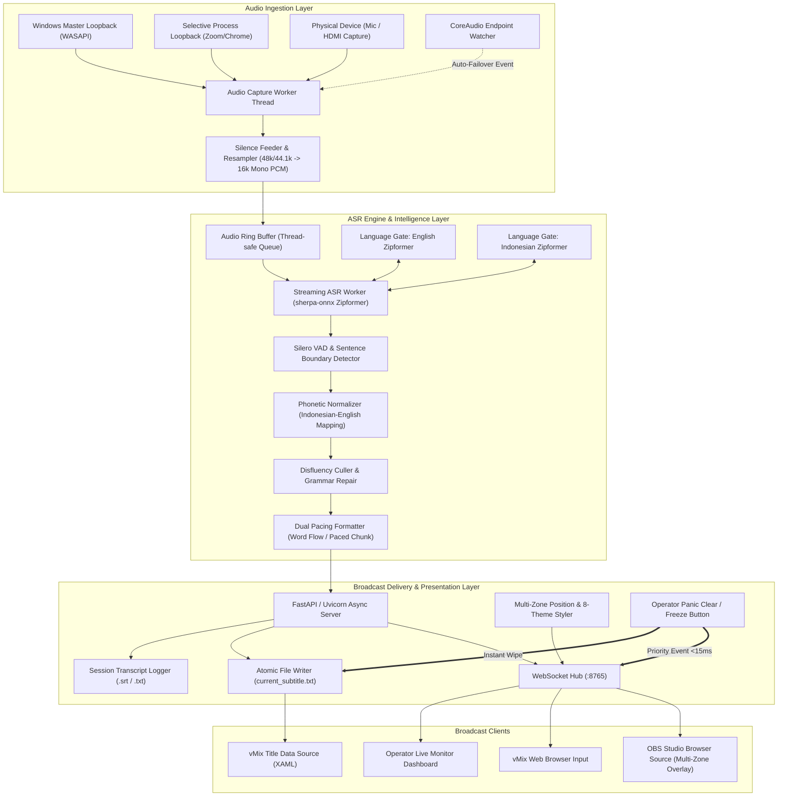

# Architecture & Technical Specifications — PUSTASUB

Dokumen ini adalah *Single Source of Truth* untuk arsitektur sistem, aliran data (*data flow*), pola konkurensi, dan spesifikasi teknologi yang digunakan pada PUSTASUB.

---

## 1. System High-Level Architecture

PUSTASUB dibangun sebagai aplikasi desktop modular berbasis Python dengan arsitektur multi-threaded / asynchronous event-driven.



---

## 2. Core Tech Stack

| Layer | Teknologi | Justifikasi Teknis |
|---|---|---|
| **Core Runtime** | Python 3.10+ (Windows Embedded) | Ringan, modular, ekosistem speech AI matang, dapat dibungkus tanpa compiler external. |
| **Streaming ASR** | `sherpa-onnx` (Zipformer English & Indonesian) | Next-gen Kaldi C++ engine dengan ONNX Runtime, latensi <250ms, konsumsi CPU <6%, RAM <150MB. |
| **Language Gate** | In-Memory Model Pool Switcher | Memungkinkan pergantian model bahasa secara instan di dashboard tanpa restart server. |
| **Audio Capture** | `PyAudioWPatch` + Windows Process Loopback | Mendukung perekaman Master Output Loopback maupun isolasi proses aplikasi (Zoom/Chrome) anti-notifikasi. |
| **Failover Watcher** | Windows CoreAudio Notification Client | Mendeteksi pencabutan headset secara dinamis dan reconnect dalam <1.5 detik. |
| **Delivery Server** | `FastAPI` + `Uvicorn` + `WebSockets` | Asynchronous, latensi transmisi sub-milidetik, serving dashboard & broadcast overlay. |
| **Frontend UI** | HTML5, CandyGlaze CSS, Vanilla JS | Zero-dependency, tampilan modern manis (*Sweet Claymorphism*), 60fps hardware accelerated. |
| **Distribution** | Inno Setup + Python Embedded Runtime | Distribusi mandiri 1-klik, kebal false positive Windows Defender, zero-install. |

---

## 3. Concurrency & Multi-Thread Architecture

Untuk menjamin latensi pemrosesan audio tidak memblokir server web dan WebSocket, PUSTASUB memisahkan tanggung jawab ke dalam 4 thread independen:

1. **Audio Capture Thread (Producer):**
   - Menarik buffer audio dari WASAPI Loopback (Master atau Selective Process) via callback non-blocking.
   - Menginjeksi silent frames jika terjadi *packet starvation* saat pembicara hening.
   - Memasukkan raw chunks ke dalam `queue.Queue(maxsize=100)`.

2. **ASR Inference & Pacing Thread (Consumer):**
   - Mengonsumsi chunk audio dari queue.
   - Menjalankan streaming decoder `sherpa-onnx` sesuai model aktif di *Language Gate*.
   - Menerapkan *Dual Pacing Formatter*:
     - *Word Flow Mode:* Mengirim event kata per kata secara langsung.
     - *Paced Chunk Mode:* Mengumpulkan kata dalam buffer 3-5 kata dan memancarkannya per frasa utuh.
   - Mengirim event teks ke Async Event Loop via `asyncio.run_coroutine_threadsafe`.

3. **Audio Endpoint Failover Watcher Thread:**
   - Thread ringan (*daemon*) yang mendengarkan notifikasi perubahan audio device dari OS Windows.
   - Jika device aktif terputus, thread memberi sinyal ke Audio Capture Thread untuk me-rebind stream ke device default baru dalam <1.5 detik.

4. **Async Server Event Loop (FastAPI / Uvicorn):**
   - Menangani koneksi HTTP dan WebSocket broadcast.
   - Memproses **Panic Clear Event** dengan prioritas interupsi tertinggi (<15ms) untuk mengosongkan layar OBS dan file vMix seketika.

---

## 4. Struktur Direktori Proyek

```
pustasub/
├── AGENTS.md                  # Single Source of Truth Persona & Rules
├── docs/                      # Kitab Suci Dokumentasi Proyek
│   ├── prd.md                 # Product Requirement Document Final (v1.1.0)
│   ├── architecture.md        # Arsitektur & Spesifikasi Teknis
│   ├── database.md            # Manajemen Data, State, & File Output
│   ├── design.md              # Design System & UI/UX Guidelines
│   ├── state-tracker.md       # Status Fitur & Milestone Tracker
│   └── distribution-guide.md  # Panduan Distribusi & Standar Operasional Siaran
├── engine/                    # Core Python Engine
│   ├── __init__.py
│   ├── config.py              # Konfigurasi port, path model, presets, default audio
│   ├── audio_capture.py       # WASAPI Loopback, Process Filter, Failover Watcher & Silence Feeder
│   ├── asr_worker.py          # sherpa-onnx streaming engine & Language Gate switcher
│   ├── text_processor.py      # Dual Pacing formatter, capitalization, punctuation & hotwords
│   ├── translator.py          # Hybrid Neural & Offline Fallback Translator
│   └── server.py              # FastAPI Web & WebSocket broadcasting + Panic Handler
├── models/                    # Folder model lokal sherpa-onnx (offline)
│   └── sherpa-onnx-streaming-zipformer-en-20M-2023-02-17/
├── output/                    # Folder output broadcast
│   ├── current_subtitle.txt   # File teks subtitle aktif untuk vMix
│   ├── current_translation.txt # File teks terjemahan aktif untuk vMix
│   └── sessions/              # Transkrip lengkap sesi (.srt dan .txt)
├── web/                       # Web Assets
│   ├── admin/                 # Operator Control Panel CandyGlaze (HTML/CSS/JS)
│   └── overlay/               # OBS / vMix Browser Source Overlay (HTML/CSS/JS)
├── build/                     # Script automasi pembuatan paket rilis
│   ├── bundle_runtime.py      # Script perakit paket zip portable standalone
│   └── setup_script.iss       # Script Inno Setup compiler installer .exe
├── main.py                    # Entry point PyInstaller Standalone Binary
├── run.bat                    # Script 1-klik peluncur interaktif
├── PUSTASUB.vbs               # Script 1-klik peluncur hening latar belakang
├── update.bat                 # Script 1-klik pembaruan otomatis via GitHub
└── requirements.txt           # Dependensi Python development
```

---

## 5. Security & Boundary Rules

1. **Local-Only Binding:** Default binding ke `127.0.0.1` (localhost). Opsi `0.0.0.0` dapat diaktifkan jika operator ingin mengontrol via LAN/iPad.
2. **Atomic Disk Operations:** Penulisan ke `output/current_subtitle.txt` menggunakan temporary write + `os.replace` untuk mencegah pembacaan korup oleh vMix.
3. **Panic Event High-Priority Override:** Saat tombol Panic Clear ditekan, pesan *wipe* dikirim langsung memotong antrean WebSocket dengan latensi <15ms.
