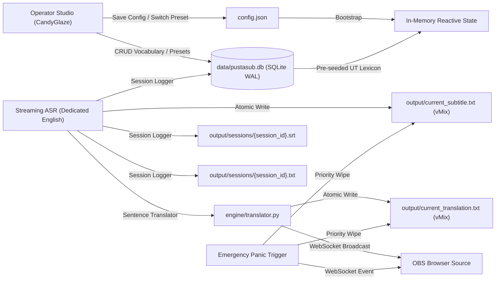

# Data Storage, File Formats & State Schema — PUSTASUB

Dokumen ini adalah *Single Source of Truth* untuk manajemen data, database SQLite offline terindeks, format file, skema konfigurasi JSON, struktur profil preset, dan skema payload WebSocket pada PUSTASUB. 

PUSTASUB menggunakan **SQLite 3 Offline Embedded Engine** (`data/pustasub.db` dengan WAL mode) standar library Python tanpa dependensi eksternal, dikombinasikan dengan file konfigurasi JSON, file teks atomik, dan in-memory reactive state untuk menjamin latensi transmisi ultra-cepat (<1ms) dan kehandalan siaran 100% offline.

---

## 1. Data Flow & Storage Overview



---

## 2. SQLite Database Schema (`data/pustasub.db`)

Database SQLite offline dikonfigurasi dengan `PRAGMA journal_mode=WAL;` dan `PRAGMA synchronous=NORMAL;` untuk performa konkurensi siaran tanpa disk blocking.

### A. Tabel `vocabulary` (Istilah Khusus & Akustik Boosting)
```sql
CREATE TABLE IF NOT EXISTS vocabulary (
    id INTEGER PRIMARY KEY AUTOINCREMENT,
    term TEXT UNIQUE NOT NULL,
    category TEXT DEFAULT 'academic',
    phonetic_hint TEXT,
    boost_score REAL DEFAULT 2.5,
    created_at TIMESTAMP DEFAULT CURRENT_TIMESTAMP
);
CREATE INDEX IF NOT EXISTS idx_vocab_term ON vocabulary(term);
```

### B. Tabel `speaker_profiles` (Badge Identitas Pembicara)
```sql
CREATE TABLE IF NOT EXISTS speaker_profiles (
    id INTEGER PRIMARY KEY AUTOINCREMENT,
    name TEXT NOT NULL,
    title TEXT NOT NULL,
    is_active INTEGER DEFAULT 0,
    created_at TIMESTAMP DEFAULT CURRENT_TIMESTAMP
);
```

### C. Tabel `presets` (8 Profil Estetika Siaran)
```sql
CREATE TABLE IF NOT EXISTS presets (
    preset_id TEXT PRIMARY KEY,
    name TEXT NOT NULL,
    config_json TEXT NOT NULL,
    is_default INTEGER DEFAULT 0,
    is_active INTEGER DEFAULT 0,
    updated_at TIMESTAMP DEFAULT CURRENT_TIMESTAMP
);
```

### D. Tabel `session_history` (Log Transkrip & Notulensi Siaran)
```sql
CREATE TABLE IF NOT EXISTS session_history (
    id INTEGER PRIMARY KEY AUTOINCREMENT,
    session_id TEXT NOT NULL,
    start_time REAL NOT NULL,
    end_time REAL NOT NULL,
    raw_text TEXT NOT NULL,
    formatted_text TEXT NOT NULL,
    glossary_tag TEXT,
    speaker_name TEXT,
    created_at TIMESTAMP DEFAULT CURRENT_TIMESTAMP
);
CREATE INDEX IF NOT EXISTS idx_session_hist ON session_history(session_id);
```

### E. Tabel `system_settings` (Key-Value State Offline)
```sql
CREATE TABLE IF NOT EXISTS system_settings (
    key TEXT PRIMARY KEY,
    value TEXT NOT NULL,
    updated_at TIMESTAMP DEFAULT CURRENT_TIMESTAMP
);
```

---

## 2. Configuration Schema (`config.json`)

File konfigurasi ini otomatis dimuat saat startup dan disimpan saat operator mengubah pengaturan di dashboard:

```json
{
  "server": {
    "host": "127.0.0.1",
    "port": 8765
  },
  "audio": {
    "capture_mode": "master_loopback",
    "target_process_name": "Zoom.exe",
    "device_index": null,
    "sample_rate": 16000,
    "channels": 1,
    "silence_threshold_ms": 3500,
    "auto_failover": true
  },
  "asr": {
    "active_language": "en",
    "pacing_mode": "paced_chunk",
    "model_path_en": "models/sherpa-onnx-streaming-zipformer-en-20M-2023-02-17",
    "num_threads": 2,
    "hotwords_file": "config/hotwords.txt",
    "hotwords_score": 2.5,
    "decoding_method": "modified_beam_search",
    "max_active_paths": 4,
    "smart_repair_enabled": true
  },
  "shortcuts": {
    "panic_clear_key": "Escape",
    "freeze_toggle_key": "Space"
  },
  "active_preset": "academic_formal",
  "presets": {
    "academic_formal": {
      "name": "Academic Formal (UT)",
      "font_family": "Plus Jakarta Sans, Inter, sans-serif",
      "font_size_px": 42,
      "font_color": "#FFFDF0",
      "stroke_color": "#034694",
      "stroke_width_px": 2.5,
      "background_color": "#1B1238",
      "background_opacity": 0.75,
      "max_lines": 2,
      "position": "bottom",
      "border_radius_px": 32,
      "animation_fade_ms": 300
    },
    "slide_friendly": {
      "name": "Slide-Friendly Slim",
      "font_family": "Inter, sans-serif",
      "font_size_px": 30,
      "font_color": "#FFFDF0",
      "stroke_color": "#0E21A0",
      "stroke_width_px": 2,
      "background_color": "#0E21A0",
      "background_opacity": 0.85,
      "max_lines": 1,
      "position": "bottom",
      "border_radius_px": 24,
      "animation_fade_ms": 250
    },
    "minimalist_glass": {
      "name": "Minimalist Transparent",
      "font_family": "Inter, sans-serif",
      "font_size_px": 38,
      "font_color": "#FFFDF0",
      "stroke_color": "#000000",
      "stroke_width_px": 2,
      "background_color": "transparent",
      "background_opacity": 0.0,
      "max_lines": 2,
      "position": "bottom",
      "border_radius_px": 0,
      "animation_fade_ms": 300
    },
    "talkshow_honey": {
      "name": "Talkshow Honey Accent",
      "font_family": "Plus Jakarta Sans, sans-serif",
      "font_size_px": 44,
      "font_color": "#FFDE00",
      "stroke_color": "#1B1238",
      "stroke_width_px": 3,
      "background_color": "#1B1238",
      "background_opacity": 0.65,
      "max_lines": 2,
      "position": "bottom",
      "border_radius_px": 28,
      "animation_fade_ms": 300
    },
    "glow_neon_candy": {
      "name": "Glow Neon Candy",
      "font_family": "Plus Jakarta Sans, sans-serif",
      "font_size_px": 42,
      "font_color": "#FFFDF0",
      "stroke_color": "#4D2FB2",
      "stroke_width_px": 2.5,
      "background_color": "#1B1238",
      "background_opacity": 0.85,
      "max_lines": 2,
      "position": "bottom",
      "border_radius_px": 32,
      "animation_fade_ms": 300
    },
    "news_ticker_ribbon": {
      "name": "News Ticker Ribbon",
      "font_family": "Inter, sans-serif",
      "font_size_px": 36,
      "font_color": "#FFFDF0",
      "stroke_color": "#034694",
      "stroke_width_px": 2,
      "background_color": "#034694",
      "background_opacity": 0.90,
      "max_lines": 1,
      "position": "bottom",
      "border_radius_px": 0,
      "animation_fade_ms": 250
    },
    "speech_bubble_playful": {
      "name": "Speech Bubble Playful",
      "font_family": "Outfit, sans-serif",
      "font_size_px": 40,
      "font_color": "#FFFDF0",
      "stroke_color": "#0E21A0",
      "stroke_width_px": 2,
      "background_color": "#4D2FB2",
      "background_opacity": 0.82,
      "max_lines": 2,
      "position": "bottom",
      "border_radius_px": 36,
      "animation_fade_ms": 280
    },
    "top_banner_clean": {
      "name": "Top-Banner Clean",
      "font_family": "Plus Jakarta Sans, sans-serif",
      "font_size_px": 34,
      "font_color": "#FFFDF0",
      "stroke_color": "#034694",
      "stroke_width_px": 2,
      "background_color": "#1B1238",
      "background_opacity": 0.80,
      "max_lines": 1,
      "position": "top",
      "border_radius_px": 20,
      "animation_fade_ms": 250
    }
  },
  "speaker_badge": {
    "enabled": false,
    "name": "Prof. Ojat Darojat, M.Bus., Ph.D.",
    "role": "Rektor Universitas Terbuka"
  }
  }
}
```

---

## 3. Broadcast Data Output Formats

### A. Atomic Text File: `output/current_subtitle.txt`
- **Tujuan:** Dibaca langsung oleh vMix Title XAML Data Source atau OBS Text (GDI+) Source.
- **Mekanisme Tulis:** Atomic Rename (`write to temp` $\to$ `os.replace`).
- **Format Konten:** Plain UTF-8 text, maksimal 2 baris teks yang sedang aktif diucapkan. Saat tombol Panic Clear ditekan atau saat jeda hening melebihi threshold, file seketika dikosongkan secara bersih.

### B. Session Subtitle Archive: `output/sessions/session_{YYYYMMDD_HHMMSS}.srt`
- **Format:** Standar SubRip (.srt) dengan penomoran urut dan *timecode* presisi milidetik.
```srt
1
00:00:01,200 --> 00:00:04,500
Welcome to the international academic webinar.

2
00:00:05,100 --> 00:00:08,750
Today we will discuss the future of online pedagogy.
```

### C. Session Transcript Archive: `output/sessions/session_{YYYYMMDD_HHMMSS}.txt`
- **Format:** Plain text berisi ringkasan percakapan utuh dengan penanda timestamp menit untuk arsip dokumentasi siaran.

---

## 4. WebSocket Event Payloads (Real-Time Communication)

Klien OBS Browser Source dan Operator Dashboard terhubung melalui WebSocket di `ws://127.0.0.1:8765/ws`.

### Event 1: Inkremental / Sedang Berbicara (`partial_subtitle`)
```json
{
  "event": "partial_subtitle",
  "text": "welcome to universitas terbuka international",
  "pacing_mode": "word_flow",
  "timestamp": 1729420000.123
}
```

### Event 2: Finalisasi Kalimat / Frasa (`final_subtitle`)
```json
{
  "event": "final_subtitle",
  "text": "Welcome to Universitas Terbuka international webinar.",
  "pacing_mode": "paced_chunk",
  "timestamp": 1729420002.456
}
```

### Event 3: Emergency Panic Clear (`panic_clear`)
Dipancarkan saat operator mengklik tombol Panic Clear atau menekan hotkey `Esc`:
```json
{
  "event": "panic_clear",
  "action": "instant_wipe",
  "timestamp": 1729420003.010
}
```

### Event 4: Freeze / Hold Subtitle (`freeze_subtitle`)
```json
{
  "event": "freeze_subtitle",
  "is_frozen": true,
  "timestamp": 1729420004.100
}
```

### Event 5: Audio VU Meter (30 fps)
```json
{
  "event": "vu_meter",
  "peak_level": 0.78,
  "rms_level": 0.42
}
```

### Event 6: Audio Failover Notification (`audio_failover`)
```json
{
  "event": "audio_failover",
  "status": "reconnected",
  "device_name": "Speakers (Realtek Audio)",
  "reconnect_time_ms": 1150
}
```

### Event 7: Ganti Profil Preset Instan (`apply_preset`)
```json
{
  "event": "apply_preset",
  "preset_id": "academic_formal",
  "style": {
    "font_size_px": 42,
    "font_color": "#FFFDF0",
    "background_color": "#15254F",
    "background_opacity": 0.75,
    "border_radius_px": 32
  }
}
```

### Event 8: Terjemahan Kalimat Bahasa Indonesia (`translation_sentence`)
```json
{
  "event": "translation_sentence",
  "indonesian": "Selamat datang di Universitas Terbuka.",
  "english": "Welcome to Universitas Terbuka.",
  "timestamp": 1729420005.200
}
```

---

## 5. Offline SQLite REST API Endpoints

Aplikasi mengelola kosakata dan kamus istilah akademik UT via endpoint berikut:

- `GET /api/vocabulary`: Mengembalikan seluruh daftar istilah tersimpan dari SQLite beserta kategori (`academic`, `leadership`, `faculties`, `conference`, `technology`) dan boost score.
- `POST /api/vocabulary`: Menyimpan istilah baru ke database SQLite dan langsung menginjeksi ke recognizer beam search buffer tanpa restart engine. Payload: `{"hotword": "Istilah", "category": "academic", "boost_score": 2.5}`.
- `DELETE /api/vocabulary/{term}`: Menghapus istilah dari database SQLite dan memutakhirkan memory biasing buffer.
