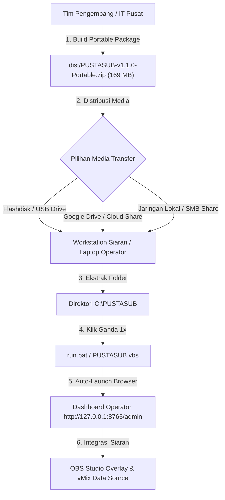
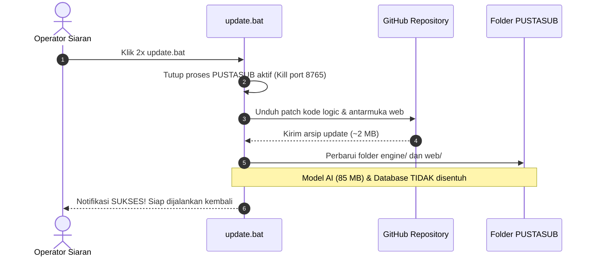

# Panduan Distribusi & Standar Operasional Siaran — PUSTASUB
### Universitas Terbuka (Pusat Perpustakaan & Layanan Terbuka)

Dokumen ini adalah Standar Operasional Prosedur (SOP) resmi mengenai cara mengemas, mendistribusikan, memasang, menjalankan, dan memperbarui aplikasi **PUSTASUB** di seluruh laptop operator dan workstation studio siaran tanpa memerlukan instalasi dependensi pihak ketiga.

---

## 1. Karakteristik Paket Distribusi

Aplikasi PUSTASUB dikemas dengan arsitektur **100% Zero-Dependency Standalone Portable**.

```
┌────────────────────────────────────────────────────────────────────────┐
│                   PUSTASUB STANDALONE PORTABLE RUNTIME                 │
├────────────────────┬───────────────────────────────────────────────────┤
│ Format Berkas      │ ZIP Portable Archive (PUSTASUB-v1.1.0-Portable.zip)│
│ Ukuran Arsip       │ ~169.7 MB (Termasuk Model AI Offline & Database) │
│ Kebutuhan Python   │ 0% — TIDAK PERLU instalasi Python di laptop target│
│ Kebutuhan Git/Pip  │ 0% — TIDAK PERLU Git, Pip, atau compiler C/C++   │
│ Hak Akses Windows  │ User Standard — TIDAK MEMBUTUHKAN izin Administrator │
│ Kebutuhan Internet │ Offline-Ready — Model pengenalan suara 100% lokal │
└────────────────────┴───────────────────────────────────────────────────┘
```

---

## 2. Alur Distribusi ke Perangkat Target



### Langkah Demi Langkah untuk Teknisi / Operator:

#### Langkah 1: Pengambilan Berkas
Salin berkas arsip `PUSTASUB-v1.1.0-Portable.zip` dari flashdisk, Google Drive institusi, atau jaringan lokal kampus ke laptop yang akan digunakan untuk siaran.

#### Langkah 2: Ekstraksi Berkas
1. Klik kanan pada `PUSTASUB-v1.1.0-Portable.zip` -> pilih **Extract All...** (atau gunakan 7-Zip / WinRAR).
2. Tentukan lokasi folder ekstraksi, sangat disarankan di direktori:
   ```
   C:\PUSTASUB
   ```
   *(Atau di folder Desktop/Documents pengguna).*

#### Langkah 3: Menjalankan Sistem
Di dalam folder hasil ekstraksi, tersedia dua pilihan peluncur:
- **`run.bat` (Sangat Direkomendasikan):** Membuka konsol siaran interaktif, secara otomatis membersihkan port 8765 jika ada proses lama yang tertahan, menampilkan log status audio, dan otomatis membuka browser ke panel admin dalam 2 detik.
- **`PUSTASUB.vbs`:** Menjalankan mesin di latar belakang tanpa memunculkan jendela hitam konsol (mode hening).

Begitu dijalankan, peramban (browser) akan otomatis membuka:
```
http://127.0.0.1:8765/admin
```

---

## 3. Konfigurasi Cepat di Panel Admin (Waktu Setup < 1 Menit)

Setelah antarmuka dashboard terbuka di laptop operator:

1. **Memilih Sumber Suara (Kartu Sumber Suara):**
   - Klik dropdown **Perangkat Audio**.
   - Pilih sumber suara siaran:
     - Jika mengambil dari mikrofon laptop/USB: Pilih nama mikrofon yang sesuai.
     - Jika mengambil dari output audio Zoom/Mixer/Soundcard: Pilih perangkat bertanda `[Loopback]`.
   - Perhatikan indikator **Gummy VU Meter**: saat ada suara/audio masuk, bar indikator ungu-kuning akan bergerak aktif secara dinamis.

2. **Memulai Penangkapan Teks:**
   - Klik tombol **MULAI TRANSSKRIPSI** di bagian kanan atas.
   - Status di badge live monitor akan berubah dari **STANDBY** menjadi **LIVE**.

3. **Memilih Gaya Tampilan (Kartu Gaya & Posisi Tampilan):**
   - Pilih salah satu dari 7 preset resmi (misal: *Pita Berita*, *Resmi Akademik*, *Balon Ceria*, atau *Wisuda Agung UT*).
   - Atur posisi layar yang diinginkan (Bawah Tengah, Bawah Kiri, Atas Banner, dll.).

---

## 4. Integrasi ke Software Siaran

### A. Integrasi ke OBS Studio (Grafis Layar Transparan)
1. Buka OBS Studio di laptop siaran.
2. Pada panel **Sources**, klik tombol **+** -> pilih **Browser**.
3. Beri nama sumber, contoh: `PUSTASUB Subtitle Overlay`.
4. Isi konfigurasi sebagai berikut:
   - **URL:** `http://127.0.0.1:8765/overlay`
   - **Width:** `1920`
   - **Height:** `1080`
   - Centang **Shutdown source when not visible**.
   - Centang **Refresh browser when scene becomes active**.
5. Klik **OK**. Kanvas subtitle transparan akan otomatis menempel rapi di layar siaran.

### B. Integrasi ke vMix (Lower-Third Title / Ticker)
1. Buka vMix di laptop siaran.
2. Klik **Add Input** -> pilih **Title / XAML** -> pilih template teks yang diinginkan.
3. Klik kanan pada thumbnail input Title tersebut -> pilih **Title Editor**.
4. Klik tombol **Data Sources** di pojok kanan atas Title Editor.
5. Klik **Manage** -> **Add** -> pilih tipe **Text File**.
6. Arahkan berkas ke:
   - Subtitle Utama (Inggris): `C:\PUSTASUB\output\current_subtitle.txt`
   - Terjemahan (Indonesia): `C:\PUSTASUB\output\current_translation.txt`
7. Subtitle dan terjemahan akan otomatis ter-update seketika (*instant stream*) saat pembicara berbicara.

---

## 5. Standar Operasional Pembaruan Instan (1-Click OTA Update)

Ketika tim pengembang memperbarui fitur atau memperbaiki antarmuka di repositori pusat GitHub (`https://github.com/pusaka-ut/pustasub.git`), operator di perangkat lapangan **TIDAK PERLU** mengunduh ulang paket 170 MB atau melakukan instalasi ulang.



### Prosedur Update bagi Operator:
1. Hubungkan laptop ke jaringan internet.
2. Jika aplikasi PUSTASUB sedang aktif, tutup terlebih dahulu.
3. Klik 2x berkas **`update.bat`** di dalam folder aplikasi.
4. Jendela pembaruan otomatis akan berjalan selama 3-5 detik:
   - Mengunduh patch perbaikan terbaru.
   - Memperbarui antarmuka web dan mesin pemroses.
   - Mempertahankan basis data kamus istilah dan model AI lokal.
5. Ketik `Y` saat muncul konfirmasi untuk langsung menjalankan aplikasi kembali.

---

## 6. Panduan Mengemas Ulang Paket (Khusus Tim IT Pusat)

Jika tim pengembang telah melakukan perubahan besar pada core engine dan ingin membuat paket rilis `.zip` baru untuk dibagikan:

1. Buka terminal atau konsol di komputer pengembang:
   ```bash
   cd C:\Users\user\Documents\Firstdeyan\pustasub
   ```
2. Jalankan script perakit otomatis:
   ```bash
   python build/bundle_runtime.py
   ```
3. Script akan otomatis:
   - Mengompilasi engine jika ada pembaruan binary.
   - Menyusun struktur folder distribusi di `dist/PUSTASUB/`.
   - Mengompresi seluruh paket menjadi `dist/PUSTASUB-v1.1.0-Portable.zip`.
4. Berkas zip di dalam folder `dist/` siap dibagikan ke seluruh unit siaran.

---

## 7. Penanganan Masalah Lapangan (Troubleshooting)

### Q1: Browser tidak terbuka otomatis saat menjalankan `run.bat`
- **Solusi:** Buka peramban secara manual (Google Chrome, Edge, atau Firefox) dan ketik alamat:
  `http://127.0.0.1:8765/admin`

### Q2: Port 8765 tertahan atau muncul pesan *Address already in use*
- **Solusi:** Cukup jalankan kembali berkas `run.bat`. Script `run.bat` telah dilengkapi logika otomatis untuk mendeteksi dan mematikan instance lama yang tertahan pada port 8765 sebelum server baru dinyalakan.

### Q3: Indikator VU Meter tidak bergerak sama sekali
- **Solusi:**
  1. Pastikan tombol **MULAI TRANSSKRIPSI** sudah diklik (status menjadi **LIVE**).
  2. Buka dropdown **Perangkat Audio**, pilih perangkat audio yang sedang aktif memutar suara (atau pilih mikrofon fisik yang terpasang).
  3. Pastikan volume sumber audio di Windows tidak dalam keadaan *Mute*.

### Q4: Muncul jendela peringatan Windows Defender Firewall
- **Solusi:** Klik **Allow access** (Izinkan akses) untuk jaringan privat (*Private Networks*) agar OBS Studio dan vMix pada komputer yang sama dapat berkomunikasi secara lokal via protokol WebSocket port 8765.

---
Dokumen ini disusun dan dipelihara oleh Tim Pengembang PUSTASUB — Universitas Terbuka.
