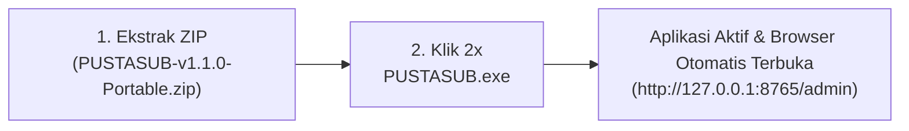

# Panduan Distribusi & Eksekusi Cepat — PUSTASUB
### Universitas Terbuka (Pusat Perpustakaan & Layanan Terbuka)

PUSTASUB telah dikemas menjadi **Aplikasi Standalone Portabel Berbasis Executable (`PUSTASUB.exe`)**. Perangkat tujuan (laptop operator/workstation studio) **SAMA SEKALI TIDAK MEMERLUKAN** instalasi Python, Git, Pip, maupun hak akses Administrator.

---

## 1. Cara Menjalankan Aplikasi (Hanya 2 Langkah)



### Langkah 1: Ekstrak Berkas
Salin dan ekstrak berkas **`PUSTASUB-v1.1.0-Portable.zip`** (tersedia di folder `dist/`) ke direktori mana pun di laptop siaran (contoh: `C:\PUSTASUB` atau di Desktop).

### Langkah 2: Jalankan `PUSTASUB.exe`
Buka folder hasil ekstraksi, lalu **klik ganda (double-click) pada berkas:**
```
PUSTASUB.exe
```

---

## 2. Apa yang Terjadi Secara Otomatis Saat `PUSTASUB.exe` Diklik?

1. **Auto-Cleanup Port:** Mesin secara otomatis mendeteksi dan mematikan proses lama jika port 8765 sedang terkunci, mencegah error *address already in use*.
2. **Zero-Dependency Engine Start:** Seluruh runtime AI (Sherpa-ONNX), driver audio WASAPI, dan FastAPI server langsung aktif dari binary internal tanpa butuh Python di Windows.
3. **Auto-Launch Browser:** Dalam 1.5 detik, peramban (Chrome/Edge) akan otomatis terbuka dan memuat antarmuka operator:
   ```
   http://127.0.0.1:8765/admin
   ```

---

## 3. Pengaturan Singkat di Panel Operator (< 30 Detik)

1. Pada kartu **Sumber Suara**, pilih mikrofon siaran atau `[Loopback]` dari audio soundcard/Zoom.
2. Pastikan indikator **VU Meter** bergerak aktif saat ada suara.
3. Klik tombol **MULAI TRANSSKRIPSI** di pojok kanan atas (status berubah menjadi **LIVE**).
4. Subtitle bahasa Inggris dan terjemahan bahasa Indonesia langsung aktif secara real-time.

---

## 4. Menghubungkan ke Software Siaran

### A. OBS Studio (Overlay Transparan)
1. Tambahkan sumber baru bertipe **Browser** di OBS.
2. Masukkan URL:
   ```
   http://127.0.0.1:8765/overlay
   ```
3. Atur resolusi: Width `1920`, Height `1080`.
4. Subtitle otomatis tampil transparan di atas video siaran.

### B. vMix (Sama Mudahnya dengan OBS)
**Metode 1: Web Browser Input (Sangat Direkomendasikan — Hanya 3 Klik):**
1. Di vMix, klik **Add Input** -> pilih **Web Browser**.
2. Masukkan URL:
   ```
   http://127.0.0.1:8765/overlay
   ```
3. Atur Width `1920` dan Height `1080`.
4. **Centang opsi "Transparent"** agar latar belakang transparan.
5. Klik **OK**, lalu aktifkan sebagai **Overlay 1 / 2** di vMix. Subtitle, animasi rolling, dan terjemahan langsung tampil mulus tanpa perlu sentuh file `.txt`.

**Metode 2: vMix GT Title Data Source (Opsional untuk Template Bawaan vMix):**
Jika ingin teks subtitle dimasukkan ke dalam template grafik lower-third bawaan vMix GT Title Designer:
1. Buka **Title Editor** di vMix -> klik **Data Sources**.
2. Hubungkan ke berkas teks lokal:
   - Subtitle Utama: `C:\PUSTASUB\output\current_subtitle.txt`
   - Terjemahan Indonesia: `C:\PUSTASUB\output\current_translation.txt`

---

## 5. Cara Memperbarui Aplikasi (Jika Ada Update dari Tim IT)

Jika ada rilis fitur baru atau perbaikan tampilan di GitHub:
1. Pastikan laptop terhubung ke internet.
2. Tutup `PUSTASUB.exe`.
3. Klik 2x berkas **`update.bat`** di dalam folder aplikasi.
4. Dalam 3 detik, modul antarmuka dan logika sistem akan tersinkronisasi ke versi terbaru tanpa perlu mengunduh ulang model AI berukuran besar (85 MB) dan tanpa merusak database kamus lokal.

---

## 6. Ringkasan File di Dalam Paket Distribusi

```
PUSTASUB/
├── PUSTASUB.exe           # Eksekutabel Utama (Klik ini untuk menjalankan)
├── _internal/             # Binary runtime C++ & Python terkompilasi
├── web/                   # Antarmuka Operator & OBS Overlay
├── models/                # Model Neural Speech Recognition Offline
├── data/                  # Basis Data Kamus Istilah Akademik UT
├── config/                # Berkas Konfigurasi Hotwords
├── output/                # Berkas Teks vMix & Log Sesi SRT
├── update.bat             # Pembaruan Instan 1-Klik dari GitHub
└── run.bat                # Peluncur alternatif mode konsol
```

---

## 7. Solusi Kendala Cepat

- **Browser tidak terbuka otomatis:** Buka manual browser dan buka `http://127.0.0.1:8765/admin`.
- **Audio tidak terbaca:** Pastikan mikrofon/soundcard sudah aktif dan izin akses mikrofon di Windows Settings dalam status *Allowed*.
- **Peringatan Windows Firewall:** Klik *Allow access* pada Private Network agar OBS dan vMix lokal dapat terhubung.
